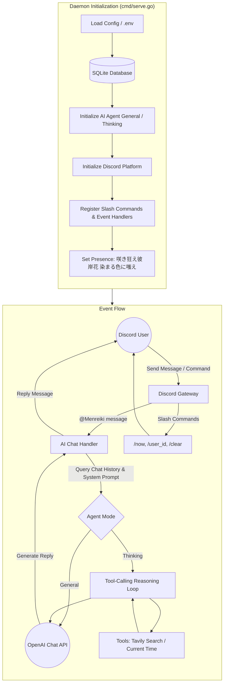

# Menreiki 面霊気

[正體中文](README.zh-TW.md) | English

> 咲き狂え彼岸花 染まる色に嗤え


Menreiki is a Discord AI agent bot written in Go (Golang), referencing the modular architecture of Isla and Schwi. Powered by the OpenAI Chat Completion API with tool-calling capabilities, Menreiki can plan, retrieve, and respond with deliberate, tool-assisted thinking (Thinking Agent) or provide fluid general conversations (General Agent).

## Architecture Overview



## Features

- High performance and minimal footprint built with Go
- Dual agent modes:
  - **General**: Fast and straightforward OpenAI conversations
  - **Thinking**: Multi-step reasoning loop (ReAct) with tool execution and fingerprint deduplication
- Pluggable tool ecosystem: Real-time web search via Tavily, system time utility (with timezone/locale awareness)
- Per-channel rolling window conversation memory (up to 30 messages)
- Works in both guild channels (requires @mention) and direct messages (DM)
- Compatible with any OpenAI-compatible API endpoint (OpenAI, Bifrost, local LLMs)
- SQLite database for startup history and automatic slash command schema synchronization
- Lightweight multi-stage Docker image

## System Requirements

- Go 1.26 or higher (for local builds)
- Or Docker / Docker Compose

## Getting Started

### 1. Create a Discord Application

1. Go to the [Discord Developer Portal](https://discord.com/developers/applications).
2. Click **New Application**, give it a name, and save the **Application ID**.
3. Open the **Bot** tab and click **Reset Token** to get your **Bot Token**.
4. Under **Privileged Gateway Intents**, enable **Message Content Intent**.
5. Go to **OAuth2 > URL Generator**, select scopes `bot` and `applications.commands`.
   Add bot permissions: **Send Messages**, **Read Message History**, **Use Slash Commands**.
6. Open the generated URL in your browser to invite the bot to your server.

### 2. Configure Environment Variables

Copy `.env.sample` to `.env`:

```bash
cp .env.sample .env
```

| Variable | Description | Default |
|---|---|---|
| `OPENAI_BASE_URL` | Base URL of your OpenAI-compatible API | `https://api.openai.com/v1` |
| `OPENAI_API_KEY` | API key for the LLM provider | (Required) |
| `OPENAI_CHAT_MODEL` | Model name to use | `gpt-4o` |
| `DISCORD_APP_ID` | Application ID from Developer Portal | (Required) |
| `DISCORD_BOT_TOKEN` | Bot token from Developer Portal | (Required) |
| `AGENT_MODE_TYPE` | Agent mode (`general` or `thinking`) | `general` |
| `AGENT_SYSTEM_PROMPT` | System prompt instruction | `You are a helpful assistant.` |
| `TAVILY_API_KEY` | Tavily Search API key (optional, enables search) | (None) |
| `DATABASE_FILE_PATH` | Path to SQLite database file | `menreiki.db` |
| `LOG_LEVEL` | Log level (`DEBUG`, `INFO`, `WARN`, `ERROR`) | `INFO` |

### 3. Run the Bot

- **Run locally**:
  ```bash
  go run ./cmd/menreiki serve
  ```

- **Run with Docker**:
  ```bash
  docker build -t menreiki .
  docker run -d --name menreiki --restart unless-stopped --env-file .env menreiki
  ```

## Slash Commands

| Command | Description |
| --- | --- |
| `/now` | Get current time |
| `/user_id` | Get user ID |
| `/clear` | Clear conversation history for the current channel |

Mention the bot (@Menreiki) in a server channel or message it in DMs to start chatting.

## License

This software is licensed under the [MIT License](LICENSE).

> (c) 2026 [Shiranui](https://shiranui.xyz).
