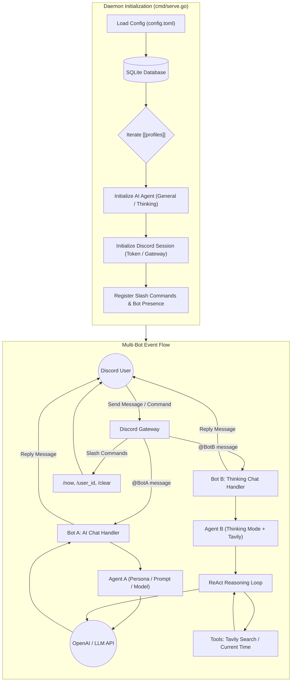

# Menreiki 面霊気

[正體中文](README.zh-TW.md) | English

> 咲き狂え彼岸花 染まる色に嗤え


Menreiki is a Discord AI agent bot written in Go (Golang), referencing the modular architecture of Isla and Schwi. Powered by the OpenAI Chat Completion API with tool-calling capabilities, Menreiki supports defining multiple independent profiles in a single TOML file, **allowing a single Menreiki instance to launch and manage multiple Discord bots with distinct personas simultaneously**.

## Architecture Overview



## Features

- High performance and minimal footprint built with Go
- **Multi-Bot Profiles**: Run multiple Discord bots concurrently in a single Menreiki process
- **Pure TOML Configuration**: No `.env` dependencies; clearly divided into `[global]` defaults and `[[profiles]]` list
- **Persona Prompt Templating**: Interpolates `{name}` and `{personality}` automatically
- Dual agent modes:
  - **General**: Fast and straightforward OpenAI conversations
  - **Thinking**: Multi-step reasoning loop (ReAct) with tool execution and fingerprint deduplication
- Pluggable tool ecosystem: Real-time web search via Tavily, system time utility (with timezone/locale awareness)
- Per-channel rolling window conversation memory (up to 30 messages)
- Works in both guild channels (requires @mention) and direct messages (DM)
- Compatible with any OpenAI-compatible API endpoint (OpenAI, Bifrost, local LLMs)
- SQLite database for startup history and automatic slash command schema synchronization
- Lightweight multi-stage Docker image

## System Requirements

- Go 1.27 or higher (for local builds)
- Or Docker / Docker Compose

## Configuration & Getting Started

Menreiki is configured entirely via TOML. If no path is specified, it defaults to `config.toml` in the current working directory.

### 1. Create `config.toml`

Copy the sample configuration file:

```bash
cp config.sample.toml config.toml
```

Example `config.toml`:

```toml
# Global defaults (inherited by all profiles if not specified)
[global]
log_level = "INFO"
database_file_path = "menreiki.db"
show_banner = true

base_url = "https://api.openai.com/v1"
api_key = "your_openai_api_key_here"
model = "gpt-4o"
mode = "general"

prompt = """
名字 -> {name}
個性 -> {personality}

語言偏好 ->
使用正體中文。
"""

# Profile 1: General Assistant Bot
[[profiles]]
name = "面靈氣一號"
personality = "溫柔體貼的助手"
token = "YOUR_FIRST_DISCORD_BOT_TOKEN"

# Profile 2: Deep Thinking / Research Bot
[[profiles]]
name = "面靈氣二號"
personality = "嚴謹理性的研究員"
token = "YOUR_SECOND_DISCORD_BOT_TOKEN"
mode = "thinking"
model = "gpt-4o"
# tavily_api_key = "your_tavily_key"
```

### 2. Running the Bot

- **Default run** (reads `config.toml` in the current working directory):
  ```bash
  go run ./cmd/menreiki serve
  ```

- **Specify a custom config path**:
  ```bash
  go run ./cmd/menreiki serve -c path/to/config.toml
  # or as an argument:
  go run ./cmd/menreiki serve path/to/config.toml
  ```

- **Specify path via environment variable**:
  ```bash
  CONFIG_FILE="path/to/config.toml" go run ./cmd/menreiki serve
  ```

### Running with Docker

```bash
# Build the Docker image
docker build -t menreiki .

# Run with a mounted config.toml
docker run -d --name menreiki --restart unless-stopped \
  -v $(pwd)/config.toml:/app/config.toml \
  menreiki serve
```

## Slash Commands

| Command | Description |
| --- | --- |
| `/now` | Get current time |
| `/user_id` | Get user ID |
| `/clear` | Clear conversation history for the current channel |

Mention the bot (@Menreiki) in a server channel or message it in DMs to start chatting.

## License

This software is licensed under the [MIT License](LICENSE).

> (c) 2026 [Shiranui](https://shiranui.xyz).
