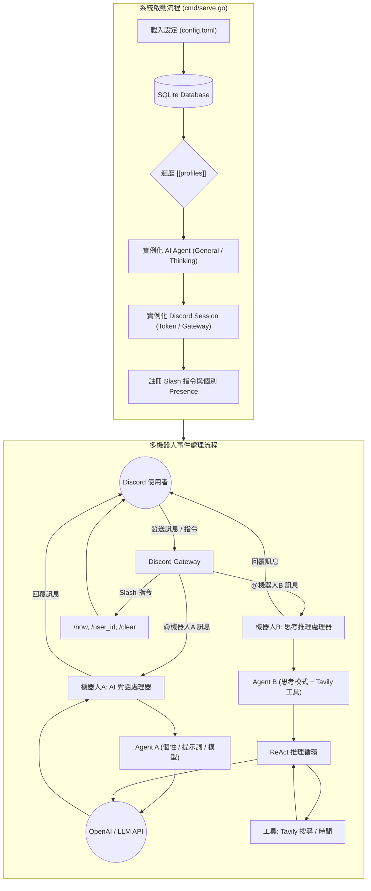

# Menreiki 面霊気

正體中文 | [English](README.md)

> 咲き狂え彼岸花 染まる色に嗤え


Menreiki 是一款基於 Go (Golang) 開發的 Discord AI 代理（Agent）機器人，參考 Isla / Schwi 模組化架構設計。搭載 OpenAI Chat Completion API 與工具調用機制，支援透過單一 TOML 設定檔定義多個獨立 Profile，**以單一面靈氣實例同時啟動多個不同個性的 Discord 機器人**。

## 系統架構



## 特色

- 基於 Go 語言的高效能與低資源消耗架構
- **支援單一實例同時運行多個 Discord 機器人（Multi-Bot Profiles）**
- **純 TOML 設定架構**：不依賴 `.env`，設定清晰分為全域預設 `[global]` 與機器人清單 `[[profiles]]`
- **Prompt 人設模板替換**：在提示詞中支援 `{name}` 與 `{personality}`，輕鬆打造不同人設
- 支援兩種 Agent 模式：
  - **General**：標準流暢的 OpenAI 對話
  - **Thinking**：具備工具調用與多步驟推理循環（ReAct）能力的思考代理
- 可插拔工具生態系統：透過 Tavily 進行網路即時搜尋、系統時間工具（支援時區與地區設定）等
- 每頻道獨立維護滾動視窗對話記憶（30 則訊息）
- 支援伺服器（Guild）頻道（需 @ 標註）與私訊（Direct Messages）
- 相容於任何符合 OpenAI 規範的 API 端點（OpenAI, Bifrost, 本地模型等）
- 內建 SQLite 資料庫記錄啟動歷史與自動同步 Slash 指令版本
- 輕量化 Docker 容器映像檔

## 系統需求

- Go 1.27 或更高版本（本機編譯）
- 或 Docker / Docker Compose

## 設定與啟動方式

Menreiki 採用純 TOML 設定檔驅動，若未指定路徑則預設讀取當前工作目錄下的 `config.toml`。

### 1. 建立 `config.toml`

複製範例設定檔：

```bash
cp config.sample.toml config.toml
```

設定檔內容範例：

```toml
# 全域預設設定（各 profile 未特別設定時將自動繼承）
[global]
log_level = "INFO"
database_file_path = "menreiki.db"
show_banner = true

base_url = "https://api.openai.com/v1"
api_key = "your_openai_api_key_here"
model = "gpt-4o"
mode = "general"

prompt = """
名字 -> {name}
個性 -> {personality}

語言偏好 ->
使用正體中文。
"""

# Profile 1：通用對話助理
[[profiles]]
name = "面靈氣一號"
personality = "溫柔體貼的助手"
token = "YOUR_FIRST_DISCORD_BOT_TOKEN"

# Profile 2：深度推理研究機器人
[[profiles]]
name = "面靈氣二號"
personality = "嚴謹理性的研究員"
token = "YOUR_SECOND_DISCORD_BOT_TOKEN"
mode = "thinking"
model = "gpt-4o"
# tavily_api_key = "your_tavily_key"
```

### 2. 啟動機器人

- **預設啟動**（讀取當前工作目錄下之 `config.toml`）：
  ```bash
  go run ./cmd/menreiki serve
  ```

- **指定設定檔路徑**：
  ```bash
  go run ./cmd/menreiki serve -c path/to/config.toml
  # 或直接作為參數傳入
  go run ./cmd/menreiki serve path/to/config.toml
  ```

- **透過環境變數指定路徑**：
  ```bash
  CONFIG_FILE="path/to/config.toml" go run ./cmd/menreiki serve
  ```

### Docker 容器化執行

```bash
# 建置映像檔
docker build -t menreiki .

# 掛載 config.toml 執行
docker run -d --name menreiki --restart unless-stopped \
  -v $(pwd)/config.toml:/app/config.toml \
  menreiki serve
```

## 指令列表

| 指令 | 說明 |
| --- | --- |
| `/now` | 取得現在時間 |
| `/user_id` | 取得使用者 ID |
| `/clear` | 清除當前頻道的對話紀錄 |

在文字頻道標註（@）機器人或在私訊中輸入訊息即可與面霊気進行對話。

## 授權條款

本軟體採用 [MIT 授權條款](LICENSE) 進行授權。

> (c) 2026 [不知火 Shiranui](https://shiranui.xyz).
