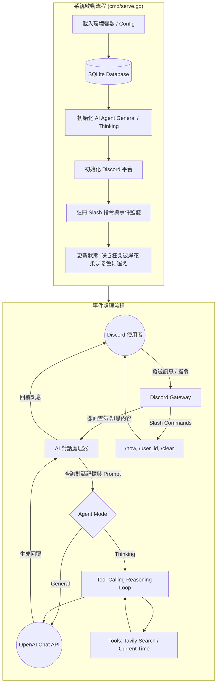

# Menreiki 面霊気

正體中文 | [English](README.md)

> 咲き狂え彼岸花 染まる色に嗤え


Menreiki 是一款基於 Go (Golang) 開發的 Discord AI 代理（Agent）機器人，參考 Isla / Schwi 模組化架構設計。搭載 OpenAI Chat Completion API 與工具調用機制，能透過多步驟推理（Thinking Agent）結合工具進行計畫、檢索與回覆。

## 系統架構



## 特色

- 基於 Go 語言的高效能與低資源消耗架構
- 支援兩種 Agent 模式：
  - **General**：標準流暢的 OpenAI 對話
  - **Thinking**：具備工具調用與多步驟推理循環（ReAct）能力的思考代理
- 可插拔工具生態系統：透過 Tavily 進行網路即時搜尋、系統時間工具（支援時區與地區設定）等
- 每頻道獨立維護滾動視窗對話記憶（30 則訊息）
- 支援伺服器（Guild）頻道（需 @ 標註）與私訊（Direct Messages）
- 相容於任何符合 OpenAI 規範的 API 端點（OpenAI, Bifrost, 本地模型等）
- 內建 SQLite 資料庫記錄啟動歷史與自動同步 Slash 指令版本
- 輕量化 Docker 容器映像檔

## 系統需求

- Go 1.26 或更高版本（本機編譯）
- 或 Docker / Docker Compose

## 開始使用

### 1. 建立 Discord 應用程式

1. 前往 [Discord Developer Portal](https://discord.com/developers/applications)。
2. 點擊 **New Application**，為其命名並儲存 **Application ID**。
3. 開啟 **Bot** 分頁，點擊 **Reset Token** 以取得您的 **Bot Token**。
4. 在 **Privileged Gateway Intents** 下，啟用 **Message Content Intent**。
5. 前往 **OAuth2 > URL Generator**，勾選 `bot` 與 `applications.commands` 範圍（Scopes）。
   新增機器人權限：**Send Messages**、**Read Message History**、**Use Slash Commands**。
6. 在瀏覽器中開啟生成的 URL，將機器人邀請至您的伺服器。

### 2. 設定環境變數

複製 `.env.sample` 並命名為 `.env`：

```bash
cp .env.sample .env
```

| 變數 | 說明 | 預設值 |
|---|---|---|
| `OPENAI_BASE_URL` | 符合 OpenAI 規範的 API 基礎網址 | `https://api.openai.com/v1` |
| `OPENAI_API_KEY` | LLM 提供者的 API 金鑰 | (必填) |
| `OPENAI_CHAT_MODEL` | 使用的模型名稱 | `gpt-4o` |
| `DISCORD_APP_ID` | 來自開發者門戶的應用程式 ID | (必填) |
| `DISCORD_BOT_TOKEN` | 來自開發者門戶的機器人 Token | (必填) |
| `AGENT_MODE_TYPE` | 代理模式 (`general` 或 `thinking`) | `general` |
| `AGENT_SYSTEM_PROMPT` | 系統提示詞 | `You are a helpful assistant.` |
| `TAVILY_API_KEY` | Tavily 搜尋 API 金鑰 (選填，啟用搜尋工具) | (無) |
| `DATABASE_FILE_PATH` | SQLite 資料庫檔案路徑 | `menreiki.db` |
| `LOG_LEVEL` | 日誌等級 (`DEBUG`, `INFO`, `WARN`, `ERROR`) | `INFO` |

### 3. 啟動機器人

- **本機啟動**：
  ```bash
  go run ./cmd/menreiki serve
  ```

- **Docker 啟動**：
  ```bash
  docker build -t menreiki .
  docker run -d --name menreiki --restart unless-stopped --env-file .env menreiki
  ```

## 指令列表

| 指令 | 說明 |
| --- | --- |
| `/now` | 取得現在時間 |
| `/user_id` | 取得使用者 ID |
| `/clear` | 清除當前頻道的對話紀錄 |

在文字頻道標註（@）機器人或在私訊中輸入訊息即可與面霊気進行對話。

## 授權條款

本軟體採用 [MIT 授權條款](LICENSE) 進行授權。

> (c) 2026 [不知火 Shiranui](https://shiranui.xyz).
